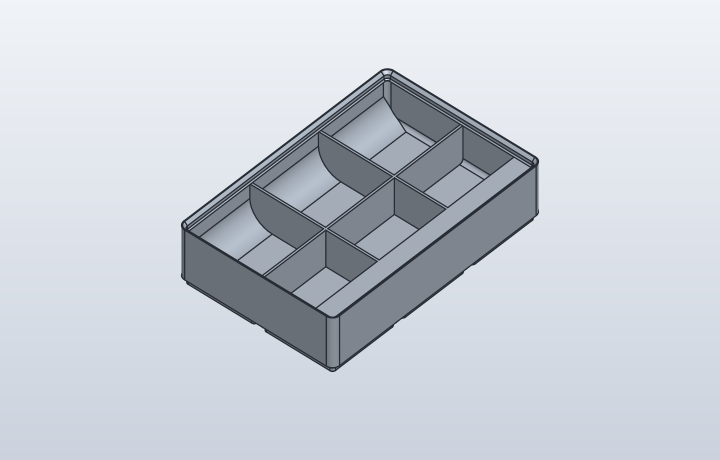
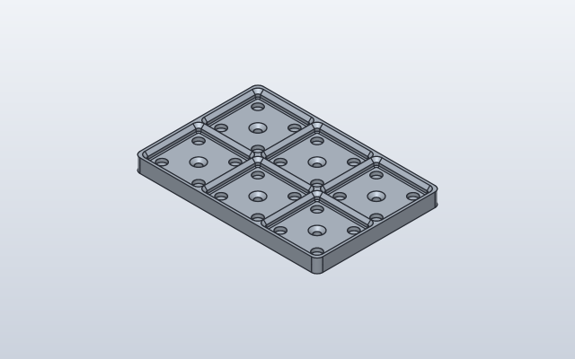
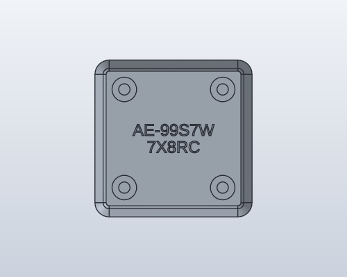

<div align="center">

# AESS

**Tough, modular, fully parametric storage for the home and the workshop.**
Gridfinity-compatible bins and baseplates, plus a web generator that turns your settings into print-ready files.

[**Open the generator → aess.billowapp.dev**](https://aess.billowapp.dev)


</div>

---

## Why AESS

[Gridfinity](https://www.youtube.com/watch?v=ra_9zU-mnl8) made modular storage easy. AESS keeps the same interface, so everything interoperates, and focuses on three things:

- **Toughness by default.** 1.6 mm walls (up to 2.5 mm), a 2.25 mm floor, a rounded inside corner where walls meet the floor, and a stacking lip with a flat top instead of a knife edge that chips. Every overhang is 45° or less, so nothing needs supports.
- **Fully parametric.** Size, walls, floor, lip, dividers, label shelf, scoop, magnets and screws are all settings, checked against each other so you can't generate something that won't print or fit.
- **Designs you can get back.** Every generated part gets a config code such as `AE-WCFJS-5ZCVN`, **engraved on its underside**. Type the code into the generator, even years and many releases later, and you get exactly the same part.

## What's in the system

| | |
|---|---|
|  | **Bins.** 1–8 × 1–8 grid units, 2–16 height units. Equal-spaced dividers in both directions, a 45° label shelf, a finger scoop, magnet and/or screw holes, and a stacking lip (or a flat top for low drawers). |
|  | **Baseplates.** 1–10 × 1–10 grid. Light open frame or solid floor with magnet pockets and countersunk mounting holes. Padding to fill a drawer exactly; *Fit to drawer* works out the grid for you. |
|  | **Config code engraving.** Under the first foot of a bin and along the front edge of a baseplate, reading the right way up when you tip the part toward you. |

Bins stack on each other the same way they sit in a baseplate, and work with any Gridfinity baseplate (and vice versa).

## Using the generator

1. Pick **Bin** or **Baseplate**, or start from a preset (*Small parts*, *Heavy tools*, *Kitchen drawer*, *Desk tray*, *Bathroom*…).
2. Adjust settings; the 3D view shows a live sketch with the outside size, inside size and compartment size.
3. **Generate**: the exact model is built on the server (about 5–40 s) and replaces the sketch.
4. Download **3MF** (slicers), **STL**, or **STEP** (CAD). Keep the code, or copy the share link (`/c/<code>`).

<details>
<summary>Phone layout</summary>

</details>

### Printing tips

PETG or ASA for toughness (PLA is fine indoors) · 0.2 mm layers · 3–4 perimeters · 15 % gyroid · no supports · 6 × 2 mm magnets with a drop of CA glue. Set the wall thickness to a multiple of your line width (1.2 / 1.6 / 2.0 / 2.4 mm for a 0.4 mm nozzle).

## How it works

```
browser ──► server/app.py ──► solidcraft-cli run <script> --in models/<model>/v<N>/model.sc
  UI + API     (stdlib Python)      parametric B-rep model ──► STL · 3MF · STEP
                │
                └── data/codes.sqlite   code → model, version, every parameter value
```

- **Models** are parametric [SolidCraft](https://solidcraft.io) designs in `models/<model>/v<N>/`. Each version has a `manifest.json` describing every parameter (range, step, default, help text), how it maps to the model (parameter changes, feature suppression), cross-checks between parameters, presets, and which text parameters receive the engraved code.
- **The server** (`server/app.py`, Python standard library only) serves the single-page UI and a small JSON API, validates every value against the manifest, stores configs under their code, and builds them with `solidcraft-cli` in a bounded worker queue. Builds are cached by code.
- **Config codes** are a hash of the canonical config (model + version + every parameter). The same design always gets the same code. A code is pinned to its model version, so later versions never change it; the UI offers to *open it in the latest version* as an explicit choice.
- **Published model versions are immutable.** `models/LOCK.json` records their checksums and the test suite fails if one changes. A change of any size goes into a new version.

### API

| Method & path | |
|---|---|
| `GET /api/models` | Every model version's manifest |
| `POST /api/configs` `{model, version?, params}` | Validate and store a config; returns its code |
| `GET /api/configs/<code>` | The stored config and its build status |
| `GET /api/configs/<code>/upgrade` | The config's values carried over to the latest model version |
| `POST /api/build/<code>` · `GET /api/build/<code>` | Queue a build / poll it |
| `GET /files/<code>/model.{stl,3mf,step}` | Built files (`?download` for a named attachment) |

## Running it yourself

Requirements: Linux or macOS, Python 3.10+, and the [SolidCraft](https://solidcraft.io/download/) CLI (`solidcraft-cli`) on `PATH` or in `AESS_SOLIDCRAFT_CLI`.

```bash
git clone <this repo> aess && cd aess
python3 server/app.py --port 8000        # http://localhost:8000
python3 -m unittest discover -s tests    # tests (SolidCraft not needed)
```

To run it as a service, see [`deploy/aess.service`](deploy/aess.service). Configuration is done with environment variables:

| Variable | Default | |
|---|---|---|
| `AESS_SOLIDCRAFT_CLI` | `solidcraft-cli` on PATH | CLI used for builds |
| `AESS_DATA` | `./data` | Code database and build cache. **Back up `codes.sqlite`.** |
| `AESS_WORKERS` | `2` | Parallel builds |
| `AESS_MAX_QUEUE` | `40` | Queue length before new builds are refused |
| `AESS_BUILDS_PER_HOUR` | `60` | Uncached builds per client IP per hour |
| `AESS_BUILD_TIMEOUT` | `600` | Seconds before a build is abandoned |

Without the website you can make quick size variants from the command line. Toggles keep the state the model file was saved in, and the engraved code is a placeholder:

```bash
solidcraft-cli run --in models/bin/v1/model.sc --param gx=3 --param gy=2 --param gz=6 --out bin.3mf
```

## Repository layout

```
models/<model>/v<N>/   model.sc + manifest.json (immutable once published), LOCK.json checksums
server/                app.py (backend) and static/ (frontend, three.js vendored)
scripts/               lock_models.py: lock / verify published model versions
tests/                 backend unit tests
deploy/                systemd unit
docs/images/           screenshots
```

## Contributing

Ideas, bug reports and new models are welcome. Read [CONTRIBUTING.md](CONTRIBUTING.md) first; in short: never edit a published model version, and every model must engrave its config code.

## License

[MIT](LICENSE). Gridfinity is an open design by Zack Freedman; AESS is an independent, compatible project. three.js is MIT-licensed (`server/static/vendor/three/LICENSE`).
