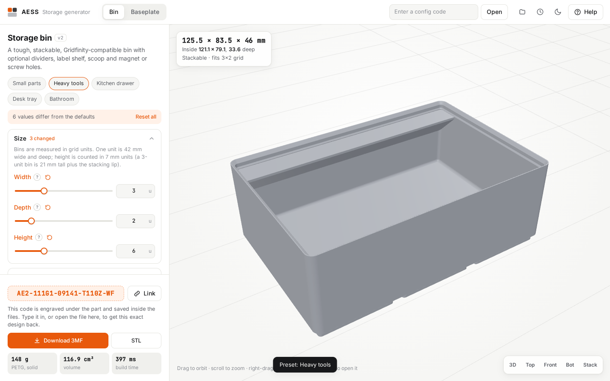
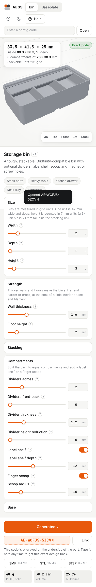

<div align="center">

# AESS

**Tough, modular, fully parametric storage for the home and the workshop.**
Gridfinity-compatible bins and baseplates, plus a web generator that turns your settings into print-ready files.

[**Open the generator → aess.billowapp.dev**](https://aess.billowapp.dev)

[](https://github.com/urnavrt-bit/aess/actions/workflows/ci.yml) [](LICENSE)



</div>

---

## Why AESS

[Gridfinity](https://www.youtube.com/watch?v=ra_9zU-mnl8) made modular storage easy. AESS keeps the same interface, so everything interoperates, and focuses on four things:

- **Toughness by default.** 1.6 mm walls (up to 2.5 mm), a 2.25 mm floor, a rounded inside corner where walls meet the floor, and a stacking lip with a flat top instead of a knife edge that chips. Every overhang is 45° or less, so nothing needs supports.
- **Fully parametric, instantly.** Size, walls, floor, lip, dividers, label shelf, scoop, magnets and screws are all settings, checked against each other. The exact model is built **in your browser** as you drag a slider (usually in under half a second), with no account and no server.
- **Designs you can get back.** Every design has a config code such as `AE2-11073-8`. The code itself holds the model, its version and your settings, it is **engraved on the part's underside**, and typing it in, even years and many releases later, gives you exactly the same part.
- **Files that remember.** Every 3MF carries its full configuration (and a thumbnail for your slicer); every STL carries the code. Drop a file back onto the generator to edit the design.

## What's in the system

| | |
|---|---|
|  | **Bins.** 1–8 × 1–8 grid units, 2–16 height units. Equal-spaced dividers in both directions, a 45° label shelf, a finger scoop, magnet and/or screw holes, and a stacking lip (or a flat top for low drawers). |
|  | **Baseplates.** 1–10 × 1–10 grid. Light open frame or solid floor with magnet pockets and countersunk mounting holes. Padding to fill a drawer exactly; *Fit to drawer* works out the grid for you. |
|  | **Config code engraving.** Under the first foot of a bin and along the front edge of a baseplate, reading the right way up when you tip the part toward you. |

Bins stack on each other the same way they sit in a baseplate, and work with any Gridfinity baseplate (and vice versa).

## Using the generator

1. Pick **Bin** or **Baseplate**, or start from a preset (*Small parts*, *Heavy tools*, *Kitchen drawer*, *Desk tray*, *Bathroom*…).
2. Adjust settings. The 3D view is the exact model, rebuilt as you go, with the outside, inside and compartment sizes. Every changed setting can be reset on its own.
3. Download **3MF** (slicers; includes the design data and a thumbnail) or **STL**.
4. Keep the code or the file, or copy the share link (`aess.billowapp.dev/?c=<code>`). Open a code with the box at the top, or drop a file anywhere on the page.

<details>
<summary>Phone layout</summary>

</details>

### Printing tips

PETG or ASA for toughness (PLA is fine indoors) · 0.2 mm layers · 3–4 perimeters · 15 % gyroid · no supports · 6 × 2 mm magnets with a drop of CA glue. Set the wall thickness to a multiple of your line width (1.2 / 1.6 / 2.0 / 2.4 mm for a 0.4 mm nozzle).

## How it works

```
 design & verify                         publish                           use (all in the browser)
 SolidCraft reference model ──┐   models/<model>/v<N>/model.js ──► Manifold (WebAssembly) ──► 3MF · STL
   (exact B-rep, by hand)     └──► tests compare volume & size       + frozen kit, font, code format
```

- **Models** are small JavaScript programs (`models/<model>/v<N>/model.js`) built on a shared geometry kit. Gridfinity's profiles are rounded rectangles that grow or shrink with height, so the kit's core is a rounded-rectangle loft, faceted to within **0.005 mm** of the true curve. [Manifold](https://github.com/elalish/manifold) does the solid booleans in WebAssembly, in a Web Worker.
- **[SolidCraft](https://solidcraft.io) is the design and reference tool.** Each browser model names a SolidCraft reference model; `scripts/make_reference.py` builds a spread of designs with it, and CI checks the browser model against them. They agree to within 0.01% in volume and exactly in size.
- **Config codes** pack the model id, version and every changed value (plus a checksum against typos) into a short base32 string. No database: the code is the design.
- **Nothing published ever changes.** Each model version pins the exact engine, font, geometry kit and code format it was built with, and `models/LOCK.json` locks all of them; CI fails if a locked file changes. Improvements go into new versions, and old codes keep building their original part. The site may offer to open a design in a newer version, but only when you choose to.

## Running it yourself

It's a static site; any web server works.

```bash
git clone https://github.com/urnavrt-bit/aess.git && cd aess
python3 scripts/build_site.py                 # assembles _site/
python3 scripts/serve.py                      # http://localhost:8000
python3 -m unittest discover -s tests         # published files are unchanged
node --test tests/js/*.test.mjs               # models, references, codes, files (Node 20+)
```

Pushing to `main` runs the tests and deploys to GitHub Pages (`.github/workflows/ci.yml`). To serve on a custom domain, set the repository variable `PAGES_CNAME`.

## Repository layout

```
web/                    the generator (app, build worker, file reader/writer, three.js)
models/<model>/v<N>/    manifest.json + model.js (browser) or model.sc (SolidCraft reference)
models/_engine|_lib|_fonts|_kit|_codec/   frozen dependencies, one folder per version
models/registry.json    model ids used in codes (append-only) · models/LOCK.json checksums
scripts/                build_site, serve, lock_models, make_reference
tests/                  lock tests · tests/js model, code and file tests · tests/reference SolidCraft numbers
docs/images/            screenshots
```

## Contributing

Ideas, bug reports and new models are welcome. Read [CONTRIBUTING.md](CONTRIBUTING.md) first; in short: never edit anything published, and every model must engrave its code and carry its design in its files.

## License

[MIT](LICENSE). Gridfinity is an open design by Zack Freedman; AESS is an independent, compatible project. Bundled: three.js (MIT), Manifold (Apache-2.0), opentype.js (MIT), Atkinson Hyperlegible (SIL OFL 1.1); licences are next to each in `web/vendor/` and `models/_*/`.
